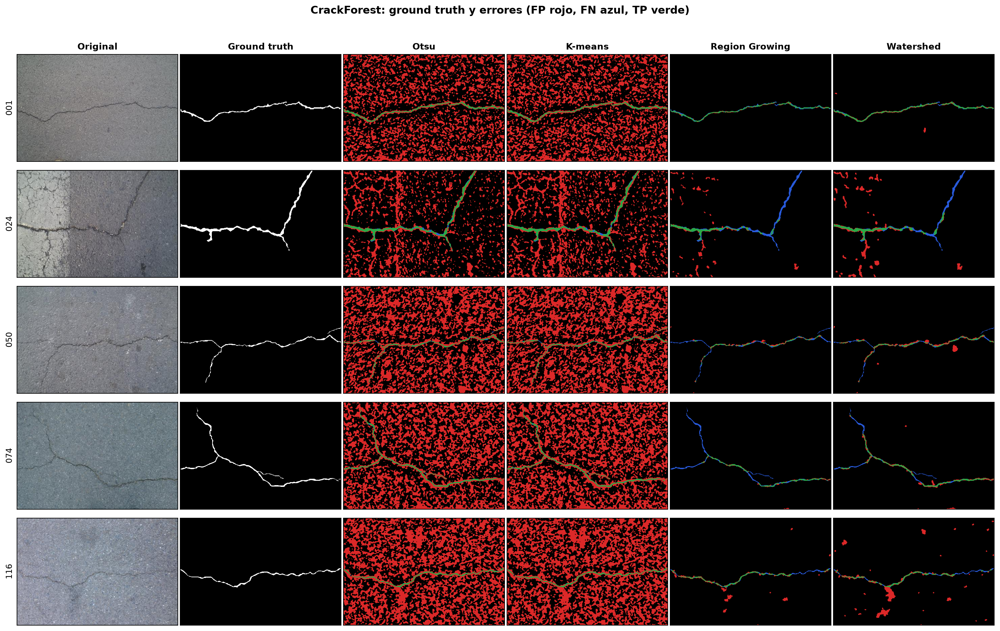
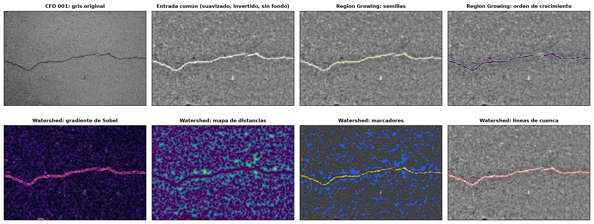
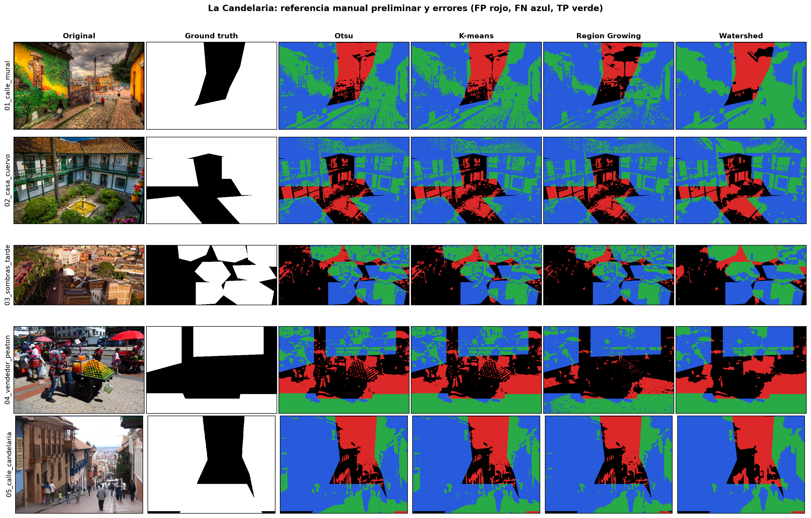

# Evaluación de segmentadores por umbralización y crecimiento de regiones frente a ground truth: CrackForest Dataset y escenas urbanas de La Candelaria

## 1. Introducción y objetivos

La segmentación divide una imagen en regiones homogéneas que corresponden a los objetos de interés. Este trabajo construye cuatro segmentadores y mide su rendimiento frente a imágenes de *ground truth* con un evaluador implementado desde cero.

**Problema principal.** Detectar grietas en pavimento con el *CrackForest Dataset* (CFD; Shi et al., 2016), que aporta anotaciones humanas oficiales. Es un problema exigente: la grieta es una estructura fina, oscura y minoritaria (1–2 % de los píxeles) sobre un asfalto muy texturizado. **Aplicación secundaria.** Segmentar la superficie construida en cinco fotografías urbanas de La Candelaria (Bogotá) con máscaras manuales propias.

**Objetivos:** (1) implementar dos métodos del Tema 10 —crecimiento de regiones por semillas y Watershed con marcadores— y dos líneas base —Otsu y K-means—; (2) implementar un evaluador propio (matriz de confusión, IoU, Dice, precisión y recall); (3) comparar los cuatro métodos sobre varias imágenes y analizar sus fallos.

## 2. Métodos de segmentación

**2.1 Preprocesamiento común.** Los cuatro métodos reciben la misma entrada, con parámetros fijos para todas las imágenes del escenario. En CFD: gris como media de R, G y B; suavizado gaussiano separable propio (σ = 1.5) para atenuar la textura; inversión 255 − I para que la grieta sea el objeto claro; y resta de fondo I′ = 4·(I − G_15∗I) + 128, que elimina la iluminación no uniforme y realza estructuras finas. En La Candelaria: reducción a lado máximo 1024 px (coste computacional), gris y suavizado σ = 1.5; las máscaras se devuelven a resolución original por vecino más cercano antes de evaluar.

**2.2 Líneas base.** *Otsu* (1979) elige el umbral t que maximiza la varianza entre clases σ_B^2(t) = [μ_T·ω(t) − μ(t)]^2 / [ω(t)·(1 − ω(t))], con ω(t) y μ(t) la probabilidad y la media acumuladas del histograma. *K-means* (MacQueen, 1967) con k = 2 sobre intensidades alterna la asignación al centroide más cercano y la actualización de medias (inicialización mín./máx., tolerancia 10^−4); el grupo claro es el objeto. Ambos deciden con un único umbral global y no usan información espacial.

**2.3 Crecimiento de regiones por semillas (Tema 10.4).** Técnica *bottom-up* de agregación local (Adams y Bischof, 1994). Semillas: píxeles con intensidad ≥ percentil P de la entrada (CFD: P = 99.8, los más oscuros del original). La región R crece por búsqueda en anchura con vecindad 8; la función de pertenencia acepta un vecino p si |I(p) − μ_R| ≤ T, donde μ_R es la media actual de la región, que se actualiza con cada inserción (CFD: T = 30; La Candelaria: P = 70, T = 25). El orden de entrada de cada píxel se guarda para visualizar la evolución del crecimiento.

**2.4 Watershed con marcadores (Tema 10.7).** La imagen se interpreta como un relieve topográfico: la magnitud del gradiente de Sobel √(G_x^2 + G_y^2). Para evitar la sobresegmentación se inunda solo desde marcadores: objeto = intensidad ≥ percentil 99.5; fondo = píxeles a más de d = 3 px de cualquier candidato (I > umbral de Otsu), según un mapa de distancias euclídeas (La Candelaria: percentil 80, d = 10). La inundación sigue el algoritmo de cola de prioridad de Meyer (1994): se extrae siempre el píxel de menor nivel, que hereda la etiqueta de la cuenca que lo alcanzó; las fronteras entre cuencas forman las líneas de división (diques).

**2.5 Autoría del código.** Todos los algoritmos —gaussiano, Sobel, Otsu, K-means, crecimiento de regiones, inundación Watershed y métricas— están implementados en NumPy/Python en *src/segmentation_lab/*. Única parte de software existente: *scipy.ndimage.distance_transform_edt* (Virtanen et al., 2020), usada para el mapa de distancias de los marcadores de fondo.

## 3. Métricas de evaluación e implementación

**3.1 Definiciones.** Para una máscara predicha S y el *ground truth* GT, ambos binarios: TP = |S ∩ GT|, FP = |S ∖ GT|, FN = |GT ∖ S| y TN = resto. Se calculan IoU = TP/(TP + FP + FN), Dice = 2TP/(2TP + FP + FN), precisión = TP/(TP + FP), recall = TP/(TP + FN) y exactitud. La exactitud se reporta pero no se usa para comparar: en CFD un detector que no marque nada obtendría ≈ 0.98 por el desbalance de clases. IoU y Dice ignoran TN y miden solapamiento real con el objeto.

**3.2 Implementación propia.** *confusion_matrix* convierte ambas máscaras a booleanos y cuenta TN, FP, FN y TP con operaciones lógicas (¬GT ∧ ¬S, ¬GT ∧ S, GT ∧ ¬S, GT ∧ S), devolviendo [[TN, FP], [FN, TP]]; *binary_metrics* deriva las cinco métricas con protección ante denominadores nulos. No se usa ninguna biblioteca de métricas. Pruebas unitarias verifican casos calculables a mano (p. ej. TP = FP = FN = TN = 1 → IoU = 1/3, Dice = 0.5). Se reportan métricas por imagen, el promedio por imagen y la matriz agregada ponderada por píxel. El notebook recalcula todo y comprueba que coincide con *deliverables/results.json*, fuente de las tablas de esta memoria.

## 4. Resultados experimentales

**4.1 CFD.** Cinco imágenes de 480×320 (IDs 001, 024, 050, 074 y 116) seleccionadas por una regla determinista sin mirar resultados (pares completos y consistentes; posiciones equidistantes sobre los IDs ordenados; se excluye 042 por desalineación conocida). *Ground truth*: *groundTruth.Segmentation*, etiqueta 2 = grieta.

| Imagen | Método | IoU | Dice | Precisión | Recall |
|---|---|---:|---:|---:|---:|
| 001 | Otsu | 0.0328 | 0.0635 | 0.0328 | 0.9945 |
| 001 | K-means | 0.0305 | 0.0592 | 0.0305 | 0.9951 |
| 001 | Region Growing | 0.6455 | 0.7846 | 0.8156 | 0.7559 |
| 001 | Watershed | 0.6524 | 0.7897 | 0.7184 | 0.8766 |
| 024 | Otsu | 0.0965 | 0.1760 | 0.0974 | 0.9127 |
| 024 | K-means | 0.0812 | 0.1502 | 0.0818 | 0.9212 |
| 024 | Region Growing | 0.2606 | 0.4134 | 0.4092 | 0.4177 |
| 024 | Watershed | 0.2563 | 0.4080 | 0.3358 | 0.5198 |
| 050 | Otsu | 0.0218 | 0.0427 | 0.0218 | 0.9380 |
| 050 | K-means | 0.0207 | 0.0406 | 0.0208 | 0.9392 |
| 050 | Region Growing | 0.3020 | 0.4639 | 0.5180 | 0.4200 |
| 050 | Watershed | 0.3342 | 0.5010 | 0.4168 | 0.6278 |
| 074 | Otsu | 0.0329 | 0.0637 | 0.0329 | 0.9802 |
| 074 | K-means | 0.0313 | 0.0608 | 0.0314 | 0.9815 |
| 074 | Region Growing | 0.3662 | 0.5361 | 0.7265 | 0.4248 |
| 074 | Watershed | 0.4348 | 0.6060 | 0.5740 | 0.6419 |
| 116 | Otsu | 0.0191 | 0.0375 | 0.0191 | 0.9914 |
| 116 | K-means | 0.0191 | 0.0375 | 0.0191 | 0.9914 |
| 116 | Region Growing | 0.3606 | 0.5300 | 0.4348 | 0.6786 |
| 116 | Watershed | 0.2191 | 0.3595 | 0.2484 | 0.6508 |

| Método (CFD) | IoU medio | Dice medio | Precisión | Recall | Matriz agregada [[TN,FP],[FN,TP]] |
|---|---:|---:|---:|---:|---|
| Otsu | 0.0406 | 0.0767 | 0.0408 | 0.9634 | `[[462309, 294896], [476, 10319]]` |
| K-means | 0.0366 | 0.0697 | 0.0367 | 0.9657 | `[[444334, 312871], [440, 10355]]` |
| Region Growing | 0.3870 | 0.5456 | 0.5808 | 0.5394 | `[[752438, 4767], [5253, 5542]]` |
| Watershed | 0.3794 | 0.5328 | 0.4587 | 0.6634 | `[[747464, 9741], [3875, 6920]]` |

### La Candelaria (métricas orientativas)

| Imagen | Método | IoU | Dice | Precisión | Recall |
|---|---|---:|---:|---:|---:|
| 01_calle_mural | Otsu | 0.4232 | 0.5947 | 0.7557 | 0.4903 |
| 01_calle_mural | K-means | 0.4181 | 0.5897 | 0.7552 | 0.4836 |
| 01_calle_mural | Region Growing | 0.2416 | 0.3892 | 0.7243 | 0.2661 |
| 01_calle_mural | Watershed | 0.4205 | 0.5921 | 0.7590 | 0.4853 |
| 02_casa_cuervo | Otsu | 0.2486 | 0.3981 | 0.6547 | 0.2861 |
| 02_casa_cuervo | K-means | 0.2486 | 0.3981 | 0.6547 | 0.2861 |
| 02_casa_cuervo | Region Growing | 0.2320 | 0.3767 | 0.6494 | 0.2653 |
| 02_casa_cuervo | Watershed | 0.2942 | 0.4547 | 0.6758 | 0.3426 |
| 03_sombras_tarde | Otsu | 0.4586 | 0.6288 | 0.7751 | 0.5290 |
| 03_sombras_tarde | K-means | 0.4548 | 0.6253 | 0.7770 | 0.5231 |
| 03_sombras_tarde | Region Growing | 0.4060 | 0.5775 | 0.8031 | 0.4509 |
| 03_sombras_tarde | Watershed | 0.4797 | 0.6483 | 0.7815 | 0.5539 |
| 04_vendedor_peaton | Otsu | 0.4186 | 0.5901 | 0.5935 | 0.5868 |
| 04_vendedor_peaton | K-means | 0.4186 | 0.5901 | 0.5935 | 0.5868 |
| 04_vendedor_peaton | Region Growing | 0.3499 | 0.5184 | 0.6984 | 0.4122 |
| 04_vendedor_peaton | Watershed | 0.3801 | 0.5509 | 0.5868 | 0.5191 |
| 05_calle_candelaria | Otsu | 0.2167 | 0.3562 | 0.5690 | 0.2592 |
| 05_calle_candelaria | K-means | 0.2195 | 0.3600 | 0.5711 | 0.2628 |
| 05_calle_candelaria | Region Growing | 0.1798 | 0.3047 | 0.5345 | 0.2131 |
| 05_calle_candelaria | Watershed | 0.1950 | 0.3263 | 0.5339 | 0.2350 |

## 5. Conclusiones

**Umbral global frente a crecimiento de regiones.** En CFD, Otsu y K-means alcanzan recall ≈ 0.96 pero precisión ≈ 0.04: el asfalto tiene muchos píxeles con la misma intensidad que la grieta y un umbral global no puede separarlos (rojo en la figura 2). Region Growing y Watershed añaden conectividad espacial: parten de semillas o marcadores fiables y solo crecen por píxeles conectados y similares. Así multiplican el Dice por ≈ 7 (RG 0.5456, WS 0.5328).

**Region Growing** es el más preciso, pero sensible a sus parámetros (tabla 3): con T = 20 crece poco (recall 0.33), y con T = 40 se desborda hacia el asfalto (precisión 0.43). Los tramos de grieta sin semilla o interrumpidos por un píxel más claro quedan sin detectar (azul en 024 y 074). **Watershed** tiene mayor recall porque el gradiente cierra tramos discontinuos, pero cada marcador de objeto que cae sobre una mancha oscura genera una cuenca falsa (manchas rojas en 116). Acercar los marcadores de fondo (d = 3) limita ese crecimiento.

**La Candelaria.** La superficie construida no corresponde a un nivel de intensidad: el cielo es claro y las fachadas en sombra son oscuras. Por eso los cuatro métodos rinden de forma parecida y limitada (Dice medio 0.43–0.51). Segmentar una clase semántica requiere color, textura o aprendizaje, no solo intensidad.

**Limitaciones.** Cinco imágenes por escenario. Los parámetros se fijaron por escenario tras un barrido exploratorio sobre las mismas imágenes evaluadas, por lo que las cifras de RG y WS son optimistas; la tabla 3 muestra cuánto varían. Las referencias de La Candelaria son polígonos manuales aproximados, no anotación experta. **Conclusión:** para estructuras finas sobre fondo texturizado, los métodos de crecimiento de regiones del Tema 10 superan claramente a la umbralización global, a costa de depender de la colocación de semillas o marcadores.

## Referencias

- Adams, R., & Bischof, L. (1994). Seeded region growing. *IEEE TPAMI*, 16(6), 641–647.
- Beucher, S., & Meyer, F. (1993). The morphological approach to segmentation: the watershed transformation. En *Mathematical Morphology in Image Processing* (pp. 433–481). Marcel Dekker.
- Gonzalez, R. C., & Woods, R. E. (2018). *Digital Image Processing* (4.ª ed.). Pearson.
- MacQueen, J. (1967). Some methods for classification and analysis of multivariate observations. *Proc. 5th Berkeley Symposium*, 1, 281–297.
- Meyer, F. (1994). Topographic distance and watershed lines. *Signal Processing*, 38(1), 113–125.
- Otsu, N. (1979). A threshold selection method from gray-level histograms. *IEEE TSMC*, 9(1), 62–66.
- Shi, Y., Cui, L., Qi, Z., Meng, F., & Chen, Z. (2016). Automatic road crack detection using random structured forests. *IEEE T-ITS*, 17(12), 3434–3445. Datos: github.com/cuilimeng/CrackForest-dataset (uso no comercial para investigación).
- UNIR. *Percepción Computacional*, Tema 10: Crecimiento de regiones.
- Virtanen, P., et al. (2020). SciPy 1.0: fundamental algorithms for scientific computing in Python. *Nature Methods*, 17, 261–272.
- Fotografías de La Candelaria (Wikimedia Commons): P. Szekely (CC BY-SA 2.0); Instituto Caro y Cuervo / J. A. Rodríguez Suárez (CC BY-SA 4.0); A. Segré (CC BY-SA 3.0); F. Restrepo Acosta (CC BY-SA 4.0); Tequendamia (dominio público). Enlaces en *data/real/sources.json*.
